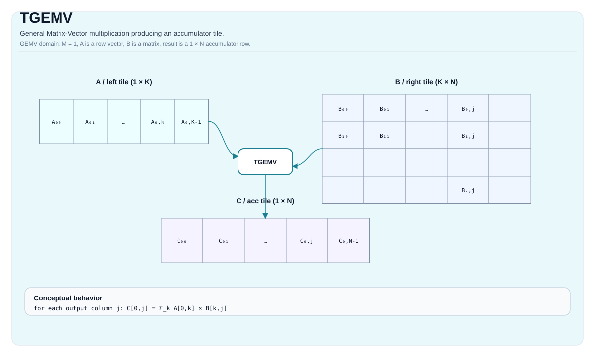

# TGEMV

## Product Support<a name="section73648168211"></a>

<!-- npu="950" id1 -->
- Ascend 950PR&950DT products: Supported
<!-- end id1 -->
<!-- npu="A3" id2 -->
- Atlas A3 products: Supported
<!-- end id2 -->
<!-- npu="910b" id3 -->
- Atlas A2 products: Supported
<!-- end id3 -->


## Tile Operation Diagram



## Introduction

General Matrix-Vector multiplication (GEMV) producing an accumulator/output tile.

## Math Interpretation

Let:

- `M = 1`
- `K = bMatrix.GetValidRow()`
- `N = bMatrix.GetValidCol()`

### 1. TGEMV (Tile-based GEMV)

For `0 <= j < N` (output elements in the effective matmul domain):

$$ \mathrm{C}_{0,j} = \sum_{k=0}^{K-1} \mathrm{A}_{0,k} \cdot \mathrm{B}_{k,j} $$

### 2. TGEMV_ACC (Tile-based GEMV with Accumulation)

For `0 <= j < N` (accumulates into existing tile):

$$ \mathrm{C}_{0,j} \gets \mathrm{C}_{0,j} + \sum_{k=0}^{K-1} \mathrm{A}_{0,k} \cdot \mathrm{B}_{k,j} $$

The existing `C` element is the initial accumulator value for the fused multiply-accumulate sequence. It is not added after computing an independent dot product from zero.

### 3. TGEMV_BIAS (Tile-based GEMV with Bias)

For `0 <= j < N` (adds bias term to matrix product):

$$ \mathrm{C}_{0,j} = \mathrm{Bias}_{0,j} + \sum_{k=0}^{K-1} \mathrm{A}_{0,k} \cdot \mathrm{B}_{k,j} $$

**Note:** For `TGEMV_BIAS`, exact accumulator behavior (including whether the bias seeds the accumulation) and datatype promotion are target/implementation-defined.

## C++ Intrinsic

Declared in `include/pto/common/pto_instr.hpp`:

```cpp
template <typename TileRes, typename TileLeft, typename TileRight, typename... WaitEvents>
PTO_INST RecordEvent TGEMV(TileRes &cMatrix, TileLeft &aMatrix, TileRight &bMatrix, WaitEvents&... events);

template <typename TileRes, typename TileLeft, typename TileRight, typename... WaitEvents>
PTO_INST RecordEvent TGEMV_ACC(TileRes &cOutMatrix, TileRes &cInMatrix, TileLeft &aMatrix, TileRight &bMatrix, WaitEvents&... events);

template <typename TileRes, typename TileLeft, typename TileRight, typename TileBias, typename... WaitEvents>
PTO_INST RecordEvent TGEMV_BIAS(TileRes &cMatrix, TileLeft &aMatrix, TileRight &bMatrix, TileBias &biasData, WaitEvents&... events);
```

## Constraints

### Common shape and location constraints

These constraints apply to `TGEMV`, `TGEMV_ACC`, and `TGEMV_BIAS` unless otherwise noted.

- Static shape constraints:
    - `TileLeft::Rows == TileRes::Rows`
    - `TileLeft::Cols == TileRight::Rows`
    - `TileRight::Cols == TileRes::Cols`
- Tile locations:
    - `TileLeft::Loc == Left`
    - `TileRight::Loc == Right`
    - `TileRes::Loc == Acc`
- Runtime valid-size constraints:
    - `m` must be `1`
    - `k` and `n` (taken from `bMatrix.GetValidRow()` and `bMatrix.GetValidCol()`) must be in `[1, 4095]`
- The `TMATMUL` accumulator pitch constraint also applies.

### TGEMV / TGEMV_ACC datatype constraints

- **Implementation checks (A2A3)**:
    - Supported `(CType, AType, BType)` triples:
        - `(int32_t, int8_t, int8_t)`
        - `(float, half, half)`
        - `(float, float, float)`
        - `(float, bfloat16_t, bfloat16_t)`
- **Implementation checks (A5)**:
    - Accumulator type must be `int32_t` or `float`.
    - If `int32_t`: `AType == int8_t` and `BType == int8_t`.
    - If `float`: supports `half`, `bfloat16_t`, `float`, selected fp8 pairs, and `hifloat8_t/hifloat8_t` (target-defined).
    - Fractal/layout constraints are enforced:
        - Left: `Loc == Left`, `!isRowMajor`, `SFractal == RowMajor`
        - Right: `Loc == Right`, `isRowMajor`, `SFractal == ColMajor`
        - Acc: `Loc == Acc`, `!isRowMajor`, `SFractal == RowMajor`

- **Implementation checks (CPU_SIM, FP8/HIF8)**: Input type combinations, A5 simulation mode, and
  numerical limits follow [TMATMUL](TMATMUL.md#constraints).

### TGEMV_BIAS additional constraints

- Bias tile datatype must exactly match `TileRes::DType`.
- Bias tile must be configured as a single row.
- Bias tile location must be `TileType::Bias`.
- **Additional A5 note**:
    - No separate explicit `m/k/n` runtime assertions are enforced in the underlying A5 matmul implementation beyond the GEMV contract described above.

## Examples

### Auto

#### 1. TGEMV

```cpp
#include <pto/pto-inst.hpp>

using namespace pto;

void example_auto() {
  using A = TileLeft<half, 1, 16>;
  using B = TileRight<half, 16, 16>;
  using C = TileAcc<float, 1, 16>;
  A a;
  B b;
  C c;
  TGEMV(c, a, b);
}
```

#### 2. TGEMV_ACC

```cpp
#include <pto/pto-inst.hpp>

using namespace pto;

void example_auto() {
  using A = TileLeft<half, 1, 16>;
  using B = TileRight<half, 16, 16>;
  using C = TileAcc<float, 1, 16>;
  A a;
  B b;
  C c0, c1;
  TGEMV_ACC(c1, c0, a, b);
}
```

#### 3. TGEMV_BIAS

```cpp
#include <pto/pto-inst.hpp>

using namespace pto;

void example_auto() {
  using A = TileLeft<half, 1, 16>;
  using B = TileRight<half, 16, 16>;
  using Bias = Tile<TileType::Bias, half, 1, 16>;
  using C = TileAcc<float, 1, 16>;
  A a;
  B b;
  Bias bias;
  C c;
  TGEMV_BIAS(c, a, b, bias);
}
```

### Manual

#### 1. TGEMV

```cpp
#include <pto/pto-inst.hpp>

using namespace pto;

void example_manual() {
  using A = TileLeft<half, 1, 16>;
  using B = TileRight<half, 16, 16>;
  using C = TileAcc<float, 1, 16>;
  A a;
  B b;
  C c;
  TASSIGN(a, 0x1000);
  TASSIGN(b, 0x2000);
  TASSIGN(c, 0x3000);
  TGEMV(c, a, b);
}
```

#### 2. TGEMV_ACC

```cpp
#include <pto/pto-inst.hpp>

using namespace pto;

void example_manual() {
  using A = TileLeft<half, 1, 16>;
  using B = TileRight<half, 16, 16>;
  using C = TileAcc<float, 1, 16>;
  A a;
  B b;
  C c0, c1;
  TASSIGN(a, 0x1000);
  TASSIGN(b, 0x2000);
  TASSIGN(c0, 0x3000);
  TASSIGN(c1, 0x4000);
  TGEMV_ACC(c1, c0, a, b);
}
```

#### 3. TGEMV_BIAS

```cpp
#include <pto/pto-inst.hpp>

using namespace pto;

void example_manual() {
  using A = TileLeft<half, 1, 16>;
  using B = TileRight<half, 16, 16>;
  using Bias = Tile<TileType::Bias, half, 1, 16>;
  using C = TileAcc<float, 1, 16>;
  A a;
  B b;
  Bias bias;
  C c;
  TASSIGN(a, 0x1000);
  TASSIGN(b, 0x2000);
  TASSIGN(bias, 0x3000);
  TASSIGN(c, 0x4000);
  TGEMV_BIAS(c, a, b, bias);
}
```
