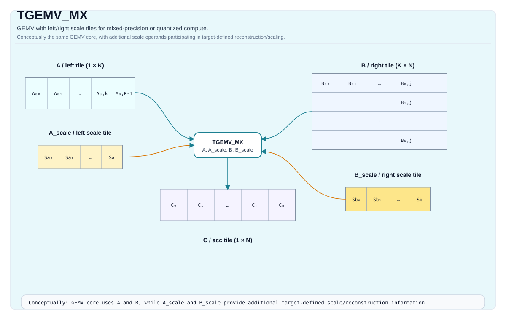

# TGEMV_MX

## Product Support<a name="section73648168211"></a>

<!-- npu="950" id1 -->
- Ascend 950PR&950DT products: Supported
<!-- end id1 -->
<!-- npu="A3" id2 -->
- Atlas A3 products: Not supported
<!-- end id2 -->
<!-- npu="910b" id3 -->
- Atlas A2 products: Not supported
<!-- end id3 -->


## Tile Operation Diagram



## Introduction

GEMV with scaling tiles for mixed-precision / quantized matrix-vector compute on supported targets.

This instruction family extends `TGEMV` with additional scale operands (mx path). Accumulator and scale handling are target-dependent.

This instruction is currently implemented on A5 and A6 (see
`include/pto/npu/a5/TMatmul.hpp` and `include/pto/npu/a6/TMatmul.hpp`).

## Math Interpretation

Conceptually (base GEMV path):

$$
\mathrm{C}_{0,j} = \sum_{k=0}^{K-1} \mathrm{A}_{0,k} \cdot \mathrm{B}_{k,j}
$$

For `TGEMV_MX`, scale tiles participate in implementation-defined mixed-precision reconstruction / scaling. The architectural contract is that output corresponds to the target-defined mx GEMV semantics.

## C++ Intrinsic

Declared in `include/pto/common/pto_instr.hpp`:

```cpp
template <typename TileRes, typename TileLeft, typename TileLeftScale, typename TileRight, typename TileRightScale,
          typename... WaitEvents>
PTO_INST RecordEvent TGEMV_MX(TileRes &cMatrix, TileLeft &aMatrix, TileLeftScale &aScaleMatrix, TileRight &bMatrix, TileRightScale &bScaleMatrix, WaitEvents &... events);

template <AccPhase Phase, typename TileRes, typename TileLeft, typename TileLeftScale, typename TileRight,
          typename TileRightScale, typename... WaitEvents>
PTO_INST RecordEvent TGEMV_MX(TileRes &cMatrix, TileLeft &aMatrix, TileLeftScale &aScaleMatrix, TileRight &bMatrix, TileRightScale &bScaleMatrix, WaitEvents &... events);

template <typename TileRes, typename TileLeft, typename TileLeftScale, typename TileRight, typename TileRightScale,
          typename... WaitEvents>
PTO_INST RecordEvent TGEMV_MX(TileRes &cOutMatrix, TileRes &cInMatrix, TileLeft &aMatrix, TileLeftScale &aScaleMatrix, TileRight &bMatrix, TileRightScale &bScaleMatrix, WaitEvents &... events);

template <AccPhase Phase, typename TileRes, typename TileLeft, typename TileLeftScale, typename TileRight,
          typename TileRightScale, typename... WaitEvents>
PTO_INST RecordEvent TGEMV_MX(TileRes &cOutMatrix, TileRes &cInMatrix, TileLeft &aMatrix, TileLeftScale &aScaleMatrix, TileRight &bMatrix, TileRightScale &bScaleMatrix, WaitEvents &... events);

template <typename TileRes, typename TileLeft, typename TileLeftScale, typename TileRight, typename TileRightScale,
          typename TileBias, typename... WaitEvents>
PTO_INST RecordEvent TGEMV_MX(TileRes &cMatrix, TileLeft &aMatrix, TileLeftScale &aScaleMatrix, TileRight &bMatrix, TileRightScale &bScaleMatrix, TileBias &biasData, WaitEvents &... events);

template <AccPhase Phase, typename TileRes, typename TileLeft, typename TileLeftScale, typename TileRight,
          typename TileRightScale, typename TileBias, typename... WaitEvents>
PTO_INST RecordEvent TGEMV_MX(TileRes &cMatrix, TileLeft &aMatrix, TileLeftScale &aScaleMatrix, TileRight &bMatrix, TileRightScale &bScaleMatrix, TileBias &biasData, WaitEvents &... events);
```

Additional overloads support accumulation/bias variants and `AccPhase` selection.

## Constraints

- Uses backend-specific mx legality checks for data types, tile locations, fractal/layout combinations, and scaling formats.
- Scale tile compatibility and accumulator promotion are implementation-defined by target backend.
- For portability, validate the exact `(A, B, scaleA, scaleB, C)` type tuple and tile layout against target implementation constraints.
- On A5, supported `(C, A, B)` triples (`C` is always `float`; scale tiles are `float8_e8m0_t`): FP8 `(float, float8_e4m3_t, float8_e4m3_t)`, `(float, float8_e4m3_t, float8_e5m2_t)`, `(float, float8_e5m2_t, float8_e4m3_t)`, `(float, float8_e5m2_t, float8_e5m2_t)`; FP4 `(float, float4_e1m2x2_t, float4_e1m2x2_t)`, `(float, float4_e1m2x2_t, float4_e2m1x2_t)`, `(float, float4_e2m1x2_t, float4_e2m1x2_t)`, `(float, float4_e2m1x2_t, float4_e1m2x2_t)`.

## Examples

For practical usage patterns, see:

- `docs/en/isa/TMATMUL_MX.md`
- `docs/en/isa/TGEMV.md`
