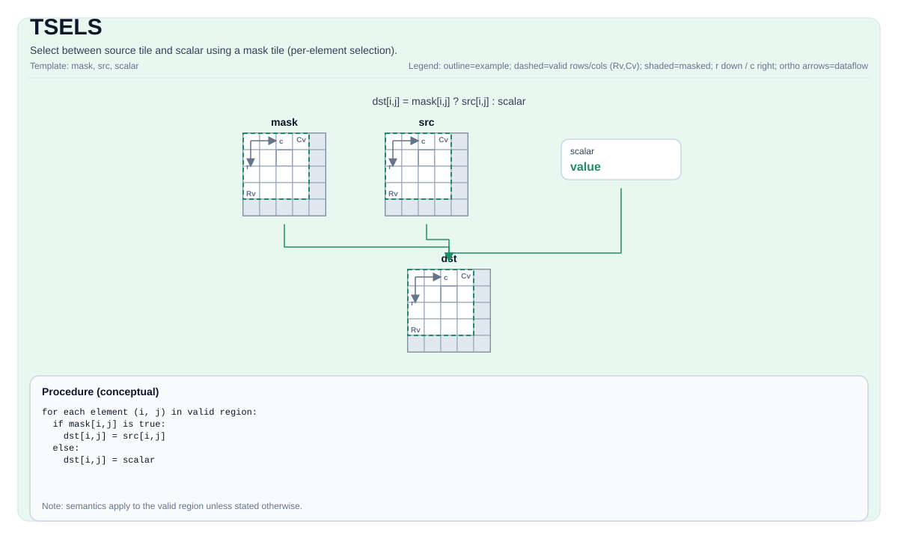

# TSELS

## Product Support<a name="section73648168211"></a>

<!-- npu="950" id1 -->
- Ascend 950PR&950DT products: Supported
<!-- end id1 -->
<!-- npu="A3" id2 -->
- Atlas A3 products: Supported
<!-- end id2 -->
<!-- npu="910b" id3 -->
- Atlas A2 products: Supported
<!-- end id3 -->


## Tile Operation Diagram



## Introduction

Select between source tile and scalar using a mask tile (per-element selection for source tile).

## Math Interpretation

For each element `(i, j)` in the valid region:

$$
\mathrm{dst}_{i,j} =
\begin{cases}
\mathrm{src}_{i,j} & \text{if } \mathrm{mask}_{i,j}\ \text{is true} \\
\mathrm{scalar} & \text{otherwise}
\end{cases}
$$

## C++ Intrinsic

Declared in `include/pto/common/pto_instr.hpp`:

```cpp
template <typename TileDataDst, typename TileDataMask, typename TileDataSrc, typename TileDataTmp, typename... WaitEvents>
PTO_INST RecordEvent TSELS(TileDataDst &dst, TileDataMask &mask, TileDataSrc &src, TileDataTmp &tmp, typename TileDataSrc::DType scalar, WaitEvents &... events);
```

## Constraints

- **Implementation checks (A2A3)**:
    - `sizeof(TileDataDst::DType)` must be `2` or `4` bytes.
    - Supported data types are 2- or 4-byte types: `int16_t`, `uint16_t`, `int32_t`, `uint32_t`, `half`, `bfloat16_t`, `float`.
    - `dst` and `src` must use the same element type.
    - `dst` and `src` must be row-major.
    - Runtime: `src.GetValidRow()/GetValidCol()` must match `dst.GetValidRow()/GetValidCol()`.
- **Implementation checks (A5)**:
    - `sizeof(TileDataDst::DType)` may be `1`, `2`, `4`, or `8` bytes.
    - Supported data types are `int8_t`, `uint8_t`, `int16_t`, `uint16_t`, `int32_t`, `uint32_t`, `int64_t`, `uint64_t`, `half`, `bfloat16_t`, and `float`.
    - `dst` and `src` must use the same element type.
    - `dst`, `mask`, and `src` must be row-major.
    - Runtime: `src.GetValidRow()/GetValidCol()` must match `dst.GetValidRow()/GetValidCol()`.
- **Valid region**:
    - The op uses `dst.GetValidRow()` / `dst.GetValidCol()` as the iteration domain.
- **Mask encoding**:
    - For 64-bit data (A5), use a RowMajor packed mask with one bit per element. Column `j` uses bit `j % 8` of byte `j / 8`; rows use the physical mask stride in bytes.
    - Masks from [TCMP](TCMP.md) or [TCMPS](TCMPS.md) may be used directly. Mask capacity must cover the destination valid region; data-tile valid columns are still counted in data elements.
    - The mask tile is interpreted as packed predicate bits in a target-defined layout.

## Temporary Space

### A2A3

`tmp` **is used** as a small buffer to store the scalar value for the `set_cmpmask` operation and to hold the comparison mask. The scalar is written to `tmp[0]` before the select loop.

- `tmp` element type must match `TileDataSrc::DType`.
- `tmp` size requirement: at least 1 element (to hold the scalar). A typical declaration: `Tile<TileType::Vec, float, 1, 16>` or similar.

### A5

`tmp` is accepted by the interface but **not used** by the A5 implementation. The A5 backend uses `vdup` to broadcast the scalar into a vector register and `vsel` for selection, requiring no scratch tile storage. `tmp` is retained in the C++ intrinsic signature solely for API compatibility with A2A3.

## Examples

### Auto

```cpp
#include <pto/pto-inst.hpp>

using namespace pto;

void example_auto() {
  using TileDst = Tile<TileType::Vec, float, 16, 16>;
  using TileSrc = Tile<TileType::Vec, float, 16, 16>;
  using TileTmp = Tile<TileType::Vec, float, 16, 16>;
  using TileMask = Tile<TileType::Vec, uint8_t, 16, 32, BLayout::RowMajor, -1, -1>;
  TileDst dst;
  TileSrc src;
  TileTmp tmp;
  TileMask mask(16, 2);
  float scalar = 0.0f;
  TSELS(dst, mask, src, tmp, scalar);
}
```

### Manual

```cpp
#include <pto/pto-inst.hpp>

using namespace pto;

void example_manual() {
  using TileDst = Tile<TileType::Vec, float, 16, 16>;
  using TileSrc = Tile<TileType::Vec, float, 16, 16>;
  using TileTmp = Tile<TileType::Vec, float, 16, 16>;
  using TileMask = Tile<TileType::Vec, uint8_t, 16, 32, BLayout::RowMajor, -1, -1>;
  TileDst dst;
  TileSrc src;
  TileTmp tmp;
  TileMask mask(16, 2);
  float scalar = 0.0f;
  TASSIGN(src, 0x1000);
  TASSIGN(tmp, 0x2000);
  TASSIGN(dst, 0x3000);
  TASSIGN(mask, 0x4000);
  TSELS(dst, mask, src, tmp, scalar);
}
```
