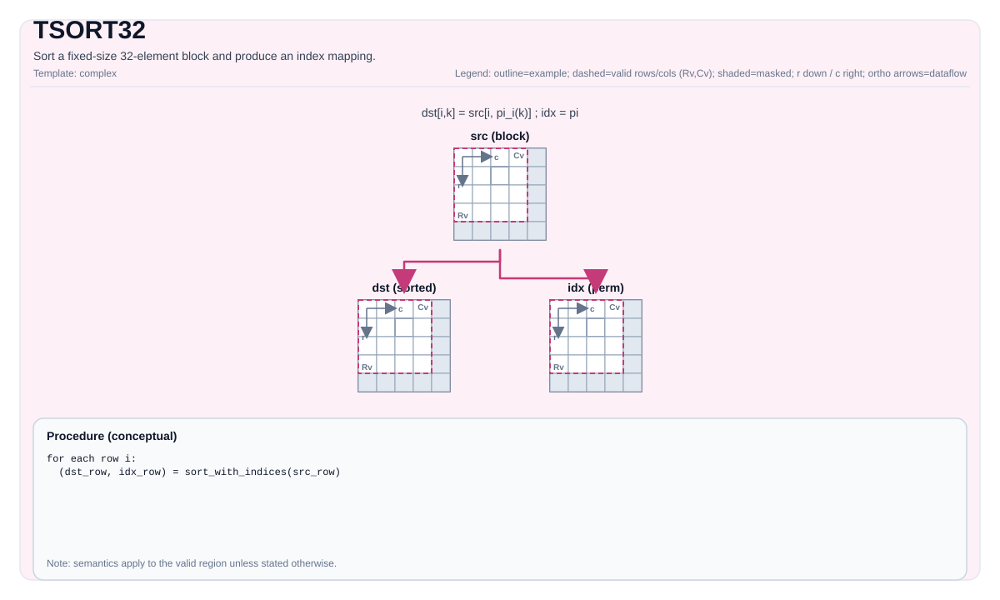

# TSORT32

## Product Support<a name="section73648168211"></a>

<!-- npu="950" id1 -->
- Ascend 950PR&950DT products: Supported
<!-- end id1 -->
<!-- npu="A3" id2 -->
- Atlas A3 products: Supported
<!-- end id2 -->
<!-- npu="910b" id3 -->
- Atlas A2 products: Supported
<!-- end id3 -->


## Tile Operation Diagram



## Introduction

Sort each 32-element block of `src` together with the corresponding indices from `idx`, and write the sorted value-index pairs into `dst`. The underlying SFU instruction is **VBS32** (`vbitsort`), which sorts one or more independent 32-element lists in a single call.

## Hardware: VBS32 (`vbitsort`)

VBS32 runs on the **SFU**. PTO maps `TSORT32` to `PIPE_V` for event synchronization. One invocation sorts `repeat` consecutive 32-element blocks, each consisting of 32 values + 32 indices packed as value-index pairs:

```cpp
void vbitsort(__ubuf__ T *dst,        // sorted value-index pairs out
              __ubuf__ T *src0,        // 32 values per block × repeat
              __ubuf__ uint32_t *src1, // 32 indices per block × repeat
              uint8_t repeat);         // number of 32-element blocks (1..255)
```

- `repeat` (cap `REPEAT_MAX = 255`) is packed into `config[63:56]`.
- Blocks are **contiguous, strided by 32 elements**: block `b` reads `src0[b*32 : b*32+32]` and `src1[b*32 : b*32+32]`, writes `dst[b*32*coef : ...]` where `coef` = 2 (float) or 4 (half) — the value-index pair expansion factor.
- Sort order: **descending** by value; equal values keep their original input order.

## Math Interpretation

For each row `r`, `src` is processed in independent 32-element blocks. Let block `b` cover columns `32b … 32b+31`, and `n_b = min(32, C - 32b)` be its valid count.

$$
(v_k, i_k) = (\mathrm{src}_{r,32b+k},\; \mathrm{idx}_{r,32b+k}), \quad 0 \le k < n_b
$$

Sort the pairs by value (descending); output the reordered sequence:

$$
[(v_{\pi(0)}, i_{\pi(0)}),\; (v_{\pi(1)}, i_{\pi(1)}),\; \ldots]
$$

where `π` is the sort permutation for that block.

Notes:
- `idx` is an input tile (indices permuted with values), not an output.
- `dst` stores sorted value-index pairs, not just sorted values.

## C++ Intrinsic

Declared in `include/pto/common/pto_instr.hpp`:

```cpp
// 3-arg: src must be 32-aligned (validCol % 32 == 0)
template <typename DstTileData, typename SrcTileData, typename IdxTileData>
PTO_INST RecordEvent TSORT32(DstTileData& dst, SrcTileData& src, IdxTileData& idx);

// 4-arg: supports non-32-aligned tails (validCol % 32 != 0) via tmp padding
template <typename DstTileData, typename SrcTileData, typename IdxTileData, typename TmpTileData>
PTO_INST RecordEvent TSORT32(DstTileData& dst, SrcTileData& src, IdxTileData& idx, TmpTileData& tmp);
```

## Tile Sizes & Data Types

For `src` of shape $R \times C$ (valid region), block size 32:

| Tile | dtype | Size (elements) | Notes |
|------|-------|-----------------|-------|
| `src` | `half` or `float` ($T$) | $R \times C$ | values to sort |
| `idx` | `uint32_t` | $R \times C$ (or $1 \times C$ broadcast) | indices permuted with values |
| `dst` | $T$ | $R \times (2C)$ float, $R \times (4C)$ half | sorted value-index pairs (expansion below) |
| `tmp` (4-arg only) | $T$ | see tmp-size equation below | tail-padding scratch |

**`dst` expansion factor** (`typeCoef`): each input element becomes an 8-byte tuple `[value (4 B), index (4 B)]` — for `float` the value fills 4 B; for `half` the 2-B value is zero-padded to 4 B. The valid output occupies `C × 8` bytes per row; physical storage must also cover the padded tail block.

| dtype | `dst` cols per `src` col (in dtype units) | tuple layout | bytes/tuple |
|-------|-------------------------------------------|--------------|------------|
| `float` | ×2 (2 float slots) | `[value_f32, index_u32]` | 8 |
| `half` | ×4 (4 half slots) | `[value_f16, 0x0000, index_u32]` | 8 |

For physical storage, let $P = \mathrm{ceil}_{32}(C)$. Allocating `src` and `idx` with $P$ columns, and `dst` with $2P$ (`float`) or $4P$ (`half`) columns, covers the full tail block and satisfies 32-byte row alignment. Set the valid columns separately to $C$ for `src`/`idx` and $2C$ or $4C$ for `dst`. The NPU reads indices and writes output for all 32 positions of the last block; padding positions are not part of the valid result.

## Constraints

| Constraint | Reason |
|------------|--------|
| `dst`/`src` dtype = `half` or `float` (must match); `idx` = `uint32_t` | VBS32 type dispatch |
| All tiles `TileType::Vec`, `BLayout::RowMajor`, `SLayout::NoneBox`; `tmp` has the same dtype as `src` | contiguous row storage and matching scratch element size |
| `src` and `dst` have the same valid row count; `idx` has that count or one broadcast row | the NPU iterates over `dst.GetValidRow()` |
| `validCol % 32 == 0` (3-arg) | each block exactly 32 elements |
| `validCol` arbitrary (4-arg) | tail block padded to 32 via `tmp` |
| `repeat = validCol/32` (3-arg) or `ceil(validCol/32)` (4-arg) | VBS32 repeat count, ≤ 255 per call; larger `validCol` splits into multiple `vbitsort` calls |
| `tmp` (4-arg) ≥ `tmpSize` elements (equation below) | holds the padded copy of the tail/row |
| No `WaitEvents&...` / no internal event synchronization | synchronize explicitly if needed |

### `tmp` size equation (4-arg)

The formula applies when `validCol % 32 != 0`; otherwise the 4-argument overload takes the aligned path without using `tmp`. One scratch row is reused for all source rows.

Let $C$ = `validCol`, $b$ = `sizeof(T)` bytes, $G$ = 32 (block size). The implementation branches on whether the whole row fits `MAX_UB_TMP = 8160`; the threshold unit differs between targets:

$$
\mathrm{tmpSize} =
\begin{cases}
\mathrm{ceil}_{G}(C) & \text{A2A3: } C \le 8160 \text{ (elements)} \;\; \text{(A5: } C \cdot b \le 8160 \text{ (bytes))} \\
G = 32 & \text{A2A3: } C > 8160 \text{ (elements)} \;\; \text{(A5: } C \cdot b > 8160 \text{ (bytes))}
\end{cases}
$$

- `ceil_G(C)` = $C$ rounded up to the next multiple of 32.
- **A2A3**: the threshold is in **elements** (`srcShapeBytesPerRow / sizeof(T) <= MAX_UB_TMP`), so $C \le 8160$ regardless of dtype (float → $C \le 8160$, half → $C \le 8160$).
- **A5**: the threshold is in **bytes** (`srcShapeBytesPerRow <= MAX_UB_TMP`), so $C \cdot b \le 8160$ (float → $C \le 2040$, half → $C \le 4080$). This is the `pto_copy_ubuf_to_ubuf` (MOV_UB_TO_UB) repeat cap = 255 blocks × 32 B.
- Tail block = $t = C \bmod G$ elements (the trailing partial block), extended to $G$ with the padding sentinel described below.
- Path A (within the target-specific threshold) copies the **entire row** from its start into tmp, then pads only the invalid positions in the last 32-element block.
- Path B (above the target-specific threshold) copies **only the tail block** into tmp; full blocks are sorted directly from `src`.
- VBS32 hard cap: `repeat ≤ REPEAT_MAX = 255` blocks per call (≤ 8160 elements); rows longer than 255 blocks are split across multiple `vbitsort` calls.
- **UB placement:** give `tmp` a separate, 32-byte-aligned region of at least `tmpSize * sizeof(T)` bytes. If it follows `dst`, start after the full physical output allocation, including the padded tail block. For example, `C = 100` and `T = half` require 128 scratch elements (256 bytes); rounding `C * sizeof(T)` to 32 bytes gives only 224 bytes and is insufficient.

### 4-arg tail handling

When `validCol % 32 != 0`, the trailing partial block ($t = C \bmod 32$ elements) must be padded to a full 32-element block before `vbitsort`. Two paths:

- **A2A3: $C \le 8160$ (elements)** / **A5: $C \cdot b \le 8160$ (bytes)** (small row): the **entire row** is copied to `tmp`, then only the invalid positions in the last 32-element block are padded; the row is sorted from `tmp`.
- **A2A3: $C > 8160$ (elements)** / **A5: $C \cdot b > 8160$ (bytes)** (large row): only the **tail block** is copied to `tmp` and padded; full blocks are sorted directly from `src`, only the tail is sorted from `tmp`.

The current A2A3 and A5 implementations use `T minVal = -(0.0 / 0.0)` as the padding sentinel. This expression produces NaN, not negative infinity; `std::numeric_limits<T>::lowest()` is a finite value and is not equivalent either. Padding positions must not be treated as valid output pairs. If `validCol > 32 × 255`, the row is chunked into `REPEAT_MAX`-sized groups, each sorted via a separate `vbitsort` call.

## Examples

The following kernel skeletons show manual UB assignment and the two overloads; input loads, output stores, and pipeline synchronization are omitted. Load the valid `src`/`idx` data and synchronize its producer before each `TSORT32` call, then synchronize before consuming `dst`. The UB regions below are 32-byte aligned and do not overlap.

```cpp
#include <cstdint>
#include <pto/pto-inst.hpp>
using namespace pto;

extern "C" __global__ AICORE void exampleAligned()
{
    // 32-aligned: single block per row
    using SrcTile = Tile<TileType::Vec, float, 1, 32>;
    using IdxTile = Tile<TileType::Vec, uint32_t, 1, 32>;
    using DstTile = Tile<TileType::Vec, float, 1, 64>; // 2× srcTile cols (float)
    SrcTile srcTile;
    IdxTile idxTile;
    DstTile dstTile;
    TASSIGN(srcTile, 0x0000);
    TASSIGN(idxTile, 0x0080);
    TASSIGN(dstTile, 0x0100);
    // Load srcTile and idxTile, then synchronize before sorting.
    TSORT32(dstTile, srcTile, idxTile);
}

extern "C" __global__ AICORE void exampleTail()
{
    // 100 valid columns, 128 physical columns: 4-arg with tmpTile
    using SrcTile = Tile<TileType::Vec, half, 1, 128, BLayout::RowMajor, 1, 100>;
    using IdxTile = Tile<TileType::Vec, uint32_t, 1, 128, BLayout::RowMajor, 1, 100>;
    // Each half value-index pair occupies four half elements.
    using DstTile = Tile<TileType::Vec, half, 1, 512, BLayout::RowMajor, 1, 400>;
    // Scratch covers ceil32(100) = 128 elements.
    using TmpTile = Tile<TileType::Vec, half, 1, 128>;
    SrcTile srcTile;
    IdxTile idxTile;
    DstTile dstTile;
    TmpTile tmpTile;
    TASSIGN(srcTile, 0x0200);
    TASSIGN(idxTile, 0x0300);
    TASSIGN(dstTile, 0x0500);
    TASSIGN(tmpTile, 0x0900);
    // Load srcTile and idxTile, then synchronize before sorting.
    TSORT32(dstTile, srcTile, idxTile, tmpTile);
}
```
