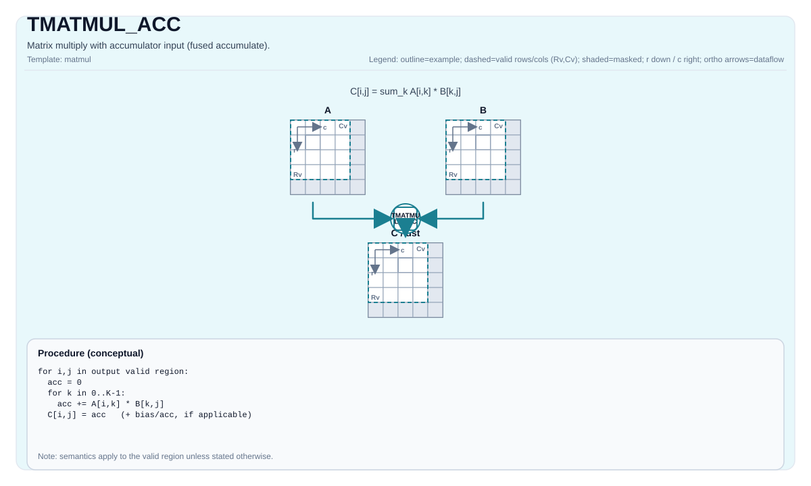

# TMATMUL_ACC

## Product Support<a name="section73648168211"></a>

<!-- npu="950" id1 -->
- Ascend 950PR&950DT products: Supported
<!-- end id1 -->
<!-- npu="A3" id2 -->
- Atlas A3 products: Supported
<!-- end id2 -->
<!-- npu="910b" id3 -->
- Atlas A2 products: Supported
<!-- end id3 -->


## Tile Operation Diagram



## Introduction

Matrix multiply with accumulator input (fused accumulate).

## Math Interpretation

Let:

- `M = aMatrix.GetValidRow()`
- `K = aMatrix.GetValidCol()`
- `N = bMatrix.GetValidCol()`

For `0 <= i < M` and `0 <= j < N`:

$$ \mathrm{C}_{i,j} \leftarrow \mathrm{C}_{i,j} + \sum_{k=0}^{K-1} \mathrm{A}_{i,k} \cdot \mathrm{B}_{k,j} $$

The operation accumulates in place: the existing value in `cMatrix` is the initial accumulator value, and the result is written back to the same tile. It is not added after computing an independent dot product from zero; this distinction can affect floating-point rounding across K tiles.

## C++ Intrinsic

Declared in `include/pto/common/pto_instr.hpp`:

```cpp
template <typename TileRes, typename TileLeft, typename TileRight, typename... WaitEvents>
PTO_INST RecordEvent TMATMUL_ACC(TileRes &cOutMatrix, TileRes &cInMatrix, TileLeft &aMatrix, TileRight &bMatrix, WaitEvents &... events);

template <AccPhase Phase, typename TileRes, typename TileLeft, typename TileRight, typename... WaitEvents>
PTO_INST RecordEvent TMATMUL_ACC(TileRes &cOutMatrix, TileRes &cInMatrix, TileLeft &aMatrix, TileRight &bMatrix, WaitEvents &... events);

template <AccPhase Phase = AccPhase::Unspecified, typename TileRes, typename TileLeft, typename TileRight,
          typename... WaitEvents>
PTO_INST RecordEvent TMATMUL_ACC(TileRes &cMatrix, TileLeft &aMatrix, TileRight &bMatrix, WaitEvents &... events); // Note: this overload uses cMatrix as both accumulator input and output (in-place), reading its current value as C0 and writing back C1 = C0 + A·B; it neither zeroes nor overwrites
```

The four-argument overload is retained for compatibility with existing call sites. Its `cOutMatrix` and `cInMatrix` must reference the same accumulator tile; Prefer the three-argument overload `TMATMUL_ACC(cMatrix, aMatrix, bMatrix)`.

> **Backend capability boundary.** The three-argument in-place overload (`cMatrix` used as both accumulator input and output) is implemented on the NPU backends (A2/A3, A5, A6, Kirin) but **not on the CPU simulator backend**. The CPU simulator's `TMATMUL_ACC_IMPL` (`include/pto/cpu/TMatmul.hpp:217`) only provides the four-argument form. Code that calls the three-argument overload will fail to compile against the CPU simulator target. When writing a kernel that must run on both CPU and NPU, use the four-argument overload with `cOutMatrix` and `cInMatrix` bound to the same tile.

## Constraints

- All constraints from `TMATMUL` apply to the `(cOutMatrix, aMatrix, bMatrix)` triple.
 - **Implementation notes (A2A3/A5/A6)**:
    - `TMATMUL_ACC_IMPL` uses `aMatrix.GetValidRow()`, `aMatrix.GetValidCol()`, and `bMatrix.GetValidCol()` for `m/k/n`.
    - The four-argument form requires `cOutMatrix.data() == cInMatrix.data()`; the underlying instruction takes a single C-matrix address, so accumulator input and output must use the same tile or the same address alias.

- **Implementation checks (CPU_SIM, FP8/HIF8)**: Input type combinations, A5 simulation mode, and
  numerical limits follow [TMATMUL](TMATMUL.md#constraints).

## Examples

### Auto

```cpp
#include <pto/pto-inst.hpp>

using namespace pto;

void example_auto() {
  using A = TileLeft<half, 16, 16>;
  using B = TileRight<half, 16, 16>;
  using C = TileAcc<float, 16, 16>;
  A a;
  B b;
  C c;
  TMATMUL_ACC(c, a, b);
}
```

### Manual

```cpp
#include <pto/pto-inst.hpp>

using namespace pto;

constexpr int kTileNum = 4;

void example_manual() {
  using A = TileLeft<half, 16, 16>;
  using B = TileRight<half, 16, 16>;
  using C = TileAcc<float, 16, 16>;
  A a;
  B b;
  C c;
  TASSIGN(a, 0x1000);
  TASSIGN(b, 0x2000);
  TASSIGN(c, 0x3000);
  for (int i = 0; i < kTileNum; ++i) {
    // The first tile initializes C; subsequent tiles accumulate in place.
    if (i == 0) {
      TMATMUL(c, a, b);
    } else {
      TMATMUL_ACC(c, c, a, b);
    }
  }
}
```
