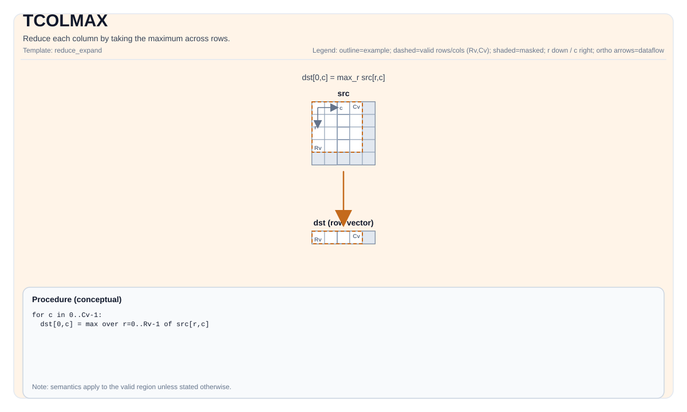

# TCOLMAX

## 产品支持情况<a name="section73648168211"></a>

<!-- npu="950" id1 -->
- Ascend 950PR&950DT系列产品：支持
<!-- end id1 -->
<!-- npu="A3" id2 -->
- Atlas A3系列产品：支持
<!-- end id2 -->
<!-- npu="910b" id3 -->
- Atlas A2系列产品：支持
<!-- end id3 -->


## 指令示意图



## 简介

通过取行间最大值来归约每一列。

## 数学语义

设 `R = src.GetValidRow()`，`C = src.GetValidCol()`。对 `0 <= j < C`：

$$ \mathrm{dst}_{0,j} = \max_{0 \le i < R} \mathrm{src}_{i,j} $$

## C++内建接口

声明于 `include/pto/common/pto_instr.hpp`：
> 公共包含头为 `<pto/pto-inst.hpp>`，内部声明位于 `pto/common/pto_instr.hpp`。

```cpp
template <typename TileDataOut, typename TileDataIn, typename... WaitEvents>
PTO_INST RecordEvent TCOLMAX(TileDataOut &dst, TileDataIn &src, WaitEvents &... events);
```

## 约束

### 通用约束或检查

- `dst` 和 `src` 必须为 `TileType::Vec`。
- `dst` 和 `src` 必须使用标准ND布局：行主且非分形（`BLayout::RowMajor`、`SLayout::NoneBox`）。
- `dst` 和 `src` 的元素类型必须一致。
- 运行时检查：
    - `src.GetValidCol() == dst.GetValidCol()`
- 若 `src.GetValidRow() == 0` 或 `src.GetValidCol() == 0`，实现会直接返回。

### Atlas A2/A3 训练系列产品/Atlas A2/A3 推理系列产品实现检查

- 支持的元素类型：`half`、`float`、`int16_t`、`int32_t`。

### Ascend 950PR/Ascend 950DT实现检查

- 支持的元素类型：`half`、`float`、`int8_t`、`uint8_t`、`int16_t`、`uint16_t`、`int32_t`、`uint32_t`、`int64_t`、`uint64_t`、`bfloat16_t`。

- 对于 `int64_t` / `uint64_t`：输出有效形状应为 `[1, src.GetValidCol()]`；物理 `Cols` 是 4 的倍数，有效列数不必对齐。只写入第 0 行的有效结果，保留其余物理填充。

## 示例

### 自动（Auto）

```cpp
#include <pto/pto-inst.hpp>

using namespace pto;

void example_auto() {
  using SrcT = Tile<TileType::Vec, float, 16, 16>;
  using DstT = Tile<TileType::Vec, float, 1, 16>;
  SrcT src;
  DstT dst;
  TCOLMAX(dst, src);
}
```

### 手动（Manual）

```cpp
#include <pto/pto-inst.hpp>

using namespace pto;

void example_manual() {
  using SrcT = Tile<TileType::Vec, float, 16, 16>;
  using DstT = Tile<TileType::Vec, float, 1, 16>;
  SrcT src;
  DstT dst;
  TASSIGN(src, 0x1000);
  TASSIGN(dst, 0x2000);
  TCOLMAX(dst, src);
}
```
