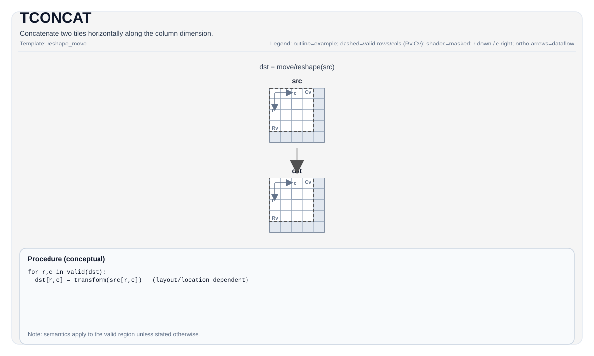
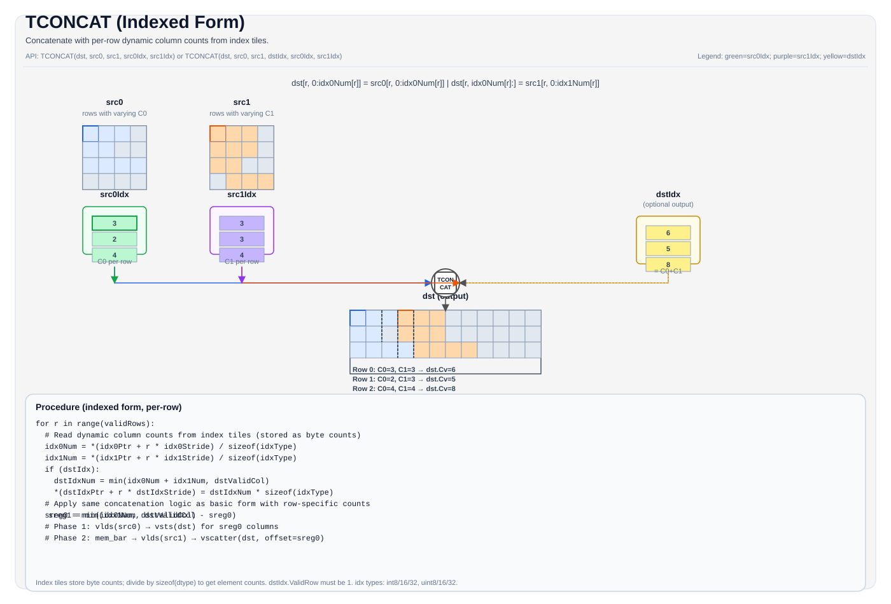

# TCONCAT

## 产品支持情况<a name="section73648168211"></a>

<!-- npu="950" id1 -->
- Ascend 950PR&950DT系列产品：支持
<!-- end id1 -->
<!-- npu="A3" id2 -->
- Atlas A3系列产品：支持
<!-- end id2 -->
<!-- npu="910b" id3 -->
- Atlas A2系列产品：支持
<!-- end id3 -->


## Tile操作示意图

### 基本形式（3参数）



### 索引形式（5-6参数）



## 简介

将两个源Tile（`src0` 和 `src1`）沿列维度水平拼接到目标Tile（`dst`）中。`dst` 的每一行包含来自 `src0` 和 `src1` 对应行的拼接结果。

`TCONCAT` 用于：

- 沿列轴拼接两个Tile（水平拼接）
- 在attention和transformer架构中拼接Tile（例如拼接KV cache条目）
- 合并来自拆分操作的局部结果

## 数学解释

对于有效区域中的每一行 `i`：

$$ \mathrm{dst}_{i, j} = \begin{cases} \mathrm{src0}_{i, j} & \text{若 } 0 \le j < \mathrm{validCols0} \\ \mathrm{src1}_{i, j - \mathrm{validCols0}} & \text{若 } \mathrm{validCols0} \le j < \mathrm{validCols0} + \mathrm{validCols1} \end{cases} $$

其中 `validCols0 = src0.GetValidCol()` 和 `validCols1 = src1.GetValidCol()`。

## C++内建函数

声明于 `include/pto/common/pto_instr.hpp`：
> 公共包含头为 `<pto/pto-inst.hpp>`，内部声明位于 `pto/common/pto_instr.hpp`。

```cpp
template <typename TileDst, typename TileSrc0, typename TileSrc1, typename... WaitEvents>
PTO_INST RecordEvent TCONCAT(TileDst &dst, TileSrc0 &src0, TileSrc1 &src1, WaitEvents &... events);

template <typename TileDst, typename TileSrc0, typename TileSrc1, typename TileSrc0Idx, typename TileSrc1Idx, typename... WaitEvents>
PTO_INST RecordEvent TCONCAT(TileDst &dst, TileSrc0 &src0, TileSrc1 &src1, TileSrc0Idx &src0Idx, TileSrc1Idx &src1Idx, WaitEvents &... events);

template <typename TileDst, typename TileSrc0, typename TileSrc1, typename TileDstIdx, typename TileSrc0Idx, typename TileSrc1Idx, typename... WaitEvents>
PTO_INST RecordEvent TCONCAT(TileDst &dst, TileSrc0 &src0, TileSrc1 &src1, TileDstIdx &dstIdx, TileSrc0Idx &src0Idx, TileSrc1Idx &src1Idx, WaitEvents &... events);
```

## 约束

### 通用约束 / 检查

- `TCONCAT` 有三种重载变体：
    - 基本形式：`TCONCAT(dst, src0, src1)` - 拼接完整有效区域
    - 索引形式（5参数）：`TCONCAT(dst, src0, src1, src0Idx, src1Idx)` - 使用每行索引Tile指定动态字节数
    - 索引形式（6参数）：`TCONCAT(dst, src0, src1, dstIdx, src0Idx, src1Idx)` - 同时输出每行拼接后的字节数
- 所有Tile必须为 `TileType::Vec`（向量Tile）
- 所有Tile必须使用行主序布局（`isRowMajor == true`）

### 形状约束

- 基本形式：
    - `dst.GetValidRow() == src0.GetValidRow() == src1.GetValidRow()`
    - Atlas A2/A3 训练系列产品/Atlas A2/A3 推理系列产品：`src0.GetValidCol() + src1.GetValidCol() <= TileDataDst::Cols`（总列数不得超过dst物理容量）
    - Ascend 950PR/Ascend 950DT：`dst.GetValidCol() == src0.GetValidCol() + src1.GetValidCol()`（总列数必须等于dst有效列数）
- 索引形式：
    - 行数约束与基本形式相同
    - 每行索引Tile的首个元素表示字节数。实现将其除以索引元素大小得到源列数，并将拼接结果裁剪到 `dst.GetValidCol()`。
    - 6参数形式要求 `dstIdx.GetValidCol() == 1`；每个输出元素保存裁剪后拼接列数对应的字节数。

### Atlas A2/A3索引形式实现行为

- 完整向量repeat与剩余的掩码尾段分别拷贝。
- 当源数据量不足一次向量repeat时，该行全部通过掩码尾段路径拷贝。
- 仅当repeat次数大于0时才执行完整repeat的`vcopy`；完整repeat次数为0时跳过该拷贝。

### 数据类型约束

- 支持的元素类型：`int8_t`、`uint8_t`、`int16_t`、`uint16_t`、`int32_t`、`uint32_t`、`half`、`bfloat16_t`、`float`
- 源Tile和目标Tile必须具有相同的元素类型
- 索引Tile必须使用整数类型（`int8_t`、`uint8_t`、`int16_t`、`uint16_t`、`int32_t`、`uint32_t`）

### Ascend 950PR/Ascend 950DT实现检查

- 所有Tile必须为 `TileType::Vec`
- 所有Tile必须为行主序布局
- `validRows` 不能超过任何操作数的物理Tile行数
- 索引Tile（如果提供）必须满足类型兼容性检查

## 示例

### Auto模式

```cpp
#include <pto/pto-inst.hpp>

using namespace pto;

void example_auto() {
    using TileT = Tile<TileType::Vec, float, 16, 32>;
    TileT src0(16, 16);
    TileT src1(16, 16);
    TileT dst(16, 32);

    TCONCAT(dst, src0, src1);
}
```

### Manual模式

```cpp
#include <pto/pto-inst.hpp>

using namespace pto;

void example_manual() {
    using TileT = Tile<TileType::Vec, half, 16, 64, BLayout::RowMajor, 16, 64>;
    TileT src0, src1, dst;

    TASSIGN(src0, 0x1000);
    TASSIGN(src1, 0x2000);
    TASSIGN(dst, 0x3000);

    src0.SetValidRegion(16, 32);
    src1.SetValidRegion(16, 32);

    TCONCAT(dst, src0, src1);
}
```

### 索引形式示例

```cpp
#include <pto/pto-inst.hpp>

using namespace pto;

void example_indexed() {
    using TileT = Tile<TileType::Vec, float, 16, 64>;
    using IdxTileT = Tile<TileType::Vec, int32_t, 16, 1>;

    TileT src0(16, 32);
    TileT src1(16, 32);
    TileT dst(16, 64);
    IdxTileT src0Idx, src1Idx;

    TCONCAT(dst, src0, src1, src0Idx, src1Idx);
}
```

## 相关指令

- [TINSERT](TINSERT.md) - 在指定偏移处将子Tile插入到目标Tile中
- [TEXTRACT](TEXTRACT.md) - 从源Tile中提取子Tile
- [TRESHAPE](TRESHAPE.md) - 将Tile重新解释为另一种Tile类型/形状
