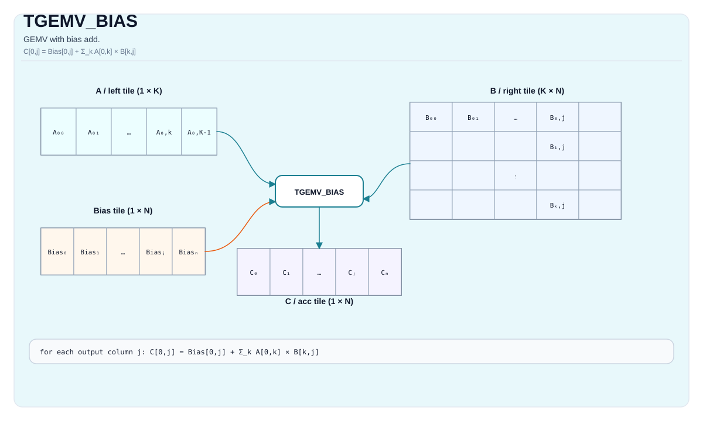

# TGEMV_BIAS

## 产品支持情况<a name="section73648168211"></a>

<!-- npu="950" id1 -->
- Ascend 950PR&950DT系列产品：支持
<!-- end id1 -->
<!-- npu="A3" id2 -->
- Atlas A3系列产品：支持
<!-- end id2 -->
<!-- npu="910b" id3 -->
- Atlas A2系列产品：支持
<!-- end id3 -->


## 指令示意图



## 简介

带偏置加法的GEMV。

## 另请参见

- 基础GEMV指令：`docs/en/isa/TGEMV.md`。
- 累加变体：`docs/en/isa/TGEMV_ACC.md`。

## C++内建接口

声明于 `include/pto/common/pto_instr.hpp`：
> 公共包含头为 `<pto/pto-inst.hpp>`，内部声明位于 `pto/common/pto_instr.hpp`。

```cpp
template <typename TileRes, typename TileLeft, typename TileRight, typename TileBias, typename... WaitEvents>
PTO_INST RecordEvent TGEMV_BIAS(TileRes &cMatrix, TileLeft &aMatrix, TileRight &bMatrix, TileBias &biasData, WaitEvents &... events);

template <AccPhase Phase, typename TileRes, typename TileLeft, typename TileRight, typename TileBias,
          typename... WaitEvents>
PTO_INST RecordEvent TGEMV_BIAS(TileRes &cMatrix, TileLeft &aMatrix, TileRight &bMatrix, TileBias &biasData, WaitEvents &... events);
```

## 数学语义

设：

- `M = 1`
- `K = bMatrix.GetValidRow()`
- `N = bMatrix.GetValidCol()`

对于 `0 <= j < N`（将偏置项加入矩阵乘积）：

$$ \mathrm{C}_{0,j} = \mathrm{Bias}_{0,j} + \sum_{k=0}^{K-1} \mathrm{A}_{0,k} \cdot \mathrm{B}_{k,j} $$

**注意：** 精确的累加器行为和数据类型提升由目标/实现定义。

## 约束

### 通用形状与位置约束

- 静态形状约束：
    - `TileLeft::Rows == TileRes::Rows`
    - `TileLeft::Cols == TileRight::Rows`
    - `TileRight::Cols == TileRes::Cols`
- Tile位置约束：
    - `TileLeft::Loc == Left`
    - `TileRight::Loc == Right`
    - `TileRes::Loc == Acc`
- 运行时有效尺寸约束：
    - `m` 必须为 `1`
    - `k` 和 `n`（取自 `bMatrix.GetValidRow()` 与 `bMatrix.GetValidCol()`）必须位于 `[1, 4095]`
- `TMATMUL` 的 Acc 步幅约束同样适用。

### 数据类型约束

- **实现检查 （Atlas A2/A3 训练系列产品/Atlas A2/A3 推理系列产品）**:
    - 支持的 `(CType, AType, BType)` 三元组：
        - `(int32_t, int8_t, int8_t)`
        - `(float, half, half)`
        - `(float, float, float)`
        - `(float, bfloat16_t, bfloat16_t)`
- **实现检查 (Ascend 950PR/Ascend 950DT)**:
    - 累加器类型必须是 `int32_t` 或 `float`。
    - 如果为 `int32_t`：`AType == int8_t` 且 `BType == int8_t`。
    - 如果为 `float`：支持 `half`、`bfloat16_t`、`float`、选定的fp8组合以及 `hifloat8_t/hifloat8_t`（目标定义）。
    - 会强制执行以下分形/布局约束：
        - Left：`Loc == Left`、`!isRowMajor`、`SFractal == RowMajor`
        - Right：`Loc == Right`、`isRowMajor`、`SFractal == ColMajor`
        - Acc：`Loc == Acc`、`!isRowMajor`、`SFractal == RowMajor`

- **实现检查（CPU_SIM，FP8/HIF8）**：输入类型组合、A5 模拟模式要求及数值精度限制与
  [TMATMUL](TMATMUL.md) 相同。

### 偏置专属约束

- 偏置tile的数据类型必须与 `TileRes::DType` 完全一致。
- 偏置tile必须配置为单行。
- 偏置tile的位置必须为 `TileType::Bias`。
- **Ascend 950PR/Ascend 950DT附加说明**：
    - 除上述GEMV约定外，底层Ascend 950PR/Ascend 950DT matmul实现不会再单独补充一组显式的 `m/k/n` 运行时断言。

## 示例

### 自动（Auto）

```cpp
#include <pto/pto-inst.hpp>

using namespace pto;

void example_auto() {
  using A = TileLeft<half, 1, 16>;
  using B = TileRight<half, 16, 16>;
  using Bias = Tile<TileType::Bias, float, 1, 16>;
  using C = TileAcc<float, 1, 16>;
  A a;
  B b;
  Bias bias;
  C c;
  TGEMV_BIAS(c, a, b, bias);
}
```

### 手动（Manual）

```cpp
#include <pto/pto-inst.hpp>

using namespace pto;

void example_manual() {
  using A = TileLeft<half, 1, 16>;
  using B = TileRight<half, 16, 16>;
  using Bias = Tile<TileType::Bias, float, 1, 16>;
  using C = TileAcc<float, 1, 16>;
  A a;
  B b;
  Bias bias;
  C c;
  TASSIGN(a, 0x1000);
  TASSIGN(b, 0x2000);
  TASSIGN(bias, 0x3000);
  TASSIGN(c, 0x4000);
  TGEMV_BIAS(c, a, b, bias);
}
```
