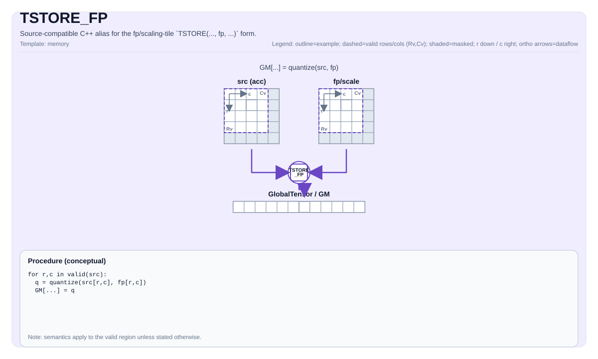

# TSTORE_FP

## 产品支持情况<a name="section73648168211"></a>

<!-- npu="950" id1 -->
- Ascend 950PR&950DT系列产品：支持
<!-- end id1 -->
<!-- npu="A3" id2 -->
- Atlas A3系列产品：支持
<!-- end id2 -->
<!-- npu="910b" id3 -->
- Atlas A2系列产品：支持
<!-- end id3 -->


## 指令示意图



## 简介

使用 `fp` Tile 作为向量量化参数，将累加器 Tile 存储到全局内存。

`TSTORE_FP(...)` 保留为历史 fp 量化存储形态的源码兼容 C++ 调用入口。它直接映射到
`TSTORE_IMPL(dst, src, fp)`。规范同名 `TSTORE(..., fp, ...)` 重载在 facade 层要求 `Scaling`
Tile；历史 alias 保留后端实现既有的合法性检查。

## 数学语义

设 `R = src.GetValidRow()`，`C = src.GetValidCol()`。概念上（二维视图，带基础偏移），对 `0 <= i < R` 且 `0 <= j < C`：

$$ \mathrm{dst}_{r_0 + i,\; c_0 + j} = \mathrm{Convert}\!\left(\mathrm{src}_{i,j};\ \mathrm{fp}\right) $$

## 汇编语法

同步形式：

```text
tstore.fp %src, %fp, %sv_out[%c0, %c0]
```

### AS Level 1（SSA）

```text
pto.tstore.fp %src, %fp, %mem : (!pto.tile<...>, !pto.tile<...>, !pto.partition_tensor_view<MxNxdtype>) -> ()
```

### AS Level 2（DPS）

```text
pto.tstore.fp ins(%src, %fp : !pto.tile_buf<...>, !pto.tile_buf<...>) outs(%mem : !pto.partition_tensor_view<MxNxdtype>)
```

## C++ 内建接口

声明于 `include/pto/common/pto_instr.hpp` 和 `include/pto/common/constants.hpp`：
> 公共包含头为 `<pto/pto-inst.hpp>`，内部声明位于 `pto/common/pto_instr.hpp`。

```cpp
template <typename TileData, typename GlobalData, typename FpTileData, AtomicType atomicType = AtomicType::AtomicNone,
          ReluPreMode reluPreMode = ReluPreMode::NoRelu, typename... WaitEvents>
PTO_INST RecordEvent TSTORE(GlobalData &dst, TileData &src, FpTileData &fp, WaitEvents &... events);

template <typename TileData, typename GlobalData, typename FpTileData, AtomicType atomicType = AtomicType::AtomicNone,
          ReluPreMode reluPreMode = ReluPreMode::NoRelu, typename... WaitEvents>
PTO_INST RecordEvent TSTORE_FP(GlobalData &dst, TileData &src, FpTileData &fp, WaitEvents &... events);

template <STPhase Phase, typename TileData, typename GlobalData, typename FpTileData,
          AtomicType atomicType = AtomicType::AtomicNone,
          ReluPreMode reluPreMode = ReluPreMode::NoRelu, typename... WaitEvents>
PTO_INST RecordEvent TSTORE_FP(GlobalData &dst, TileData &src, FpTileData &fp, WaitEvents &... events);
```

## 约束

- **实现检查 (A2A3)**:
    - fp 存储路径通过 `TSTORE_IMPL(dst, src, fp)` 实现，并使用与量化累加器存储相同的累加器到 GM 合法性检查：
    - `FpTileData` 的合法性由所选后端实现检查。
    - 目标布局必须是 ND、NZ、NC1HWC0 或 NDC1HWC0。
    - 源数据类型必须是 `int32_t` 或 `float`。
    - 静态形状约束：`1 <= TileData::Cols <= 4095`；若为 ND 则 `1 <= TileData::Rows <= 8192`；若为 NZ、NC1HWC0 或 NDC1HWC0 则 `1 <= TileData::Rows <= 65535` 且 `TileData::Cols % 16 == 0`。
    - 运行时：`1 <= src.GetValidCol() <= 4095`。
- **实现检查 (A5)**:
    - 通过 `TSTORE_IMPL(dst, src, fp)` 实现，并由 `CheckStaticAcc<..., true>()` 验证累加器路径（支持 ND/NZ/NHWC/NCHW/NCDHW，源数据类型为 `int32_t`/`float`，行/列范围有限制）。
    - `FpTileData` 的合法性由所选后端实现检查。
    - `STPhase` fp 别名仅在存在对应后端实现的目标上暴露：
      A2A3、A5、kirin9030、kirin9050 和 CPU 模拟器。
    - **在 A2A3 和 Ascend 950PR/Ascend 950DT 上**，`STPhase` 会作用到 per-channel 随路量化的搬出指令，
      因此量化与 unit flag 可以并行，配合 `TMATMUL<AccPhase::Final>` 使用时
      无需显式 `set_flag`/`wait_flag`。取值规则与 `TSTORE` 相同：
      `Final` 用于最后一次搬出并释放 unit flag，
      `Partial` 只用于同一块 L0C 分多次搬出时的非末次。
    - kirin9030 上该重载虽然暴露，但后端未把 `STPhase` 接到量化搬出指令上，传入不会生效。
    - 在 Ascend 950PR 板机、CANN 9.2.0 环境下，共用的 per-channel 量化后端通过了
      [TSTORE](TSTORE.md) 中列出的 3 个 `tstore_acc2gm` 定向用例，max diff 均为 0。

## 示例

### 自动（Auto）

```cpp
#include <pto/pto-inst.hpp>

using namespace pto;

void example_auto(__gm__ int8_t* out) {
  using AccT = TileAcc<float, 16, 16>;
  using FpT = Tile<TileType::Scaling, uint64_t, 1, 16, BLayout::RowMajor, 1, DYNAMIC, SLayout::NoneBox>;
  using GShape = Shape<1, 1, 1, 16, 16>;
  using GStride = BaseShape2D<int8_t, 16, 16, Layout::ND>;
  using GT = GlobalTensor<int8_t, GShape, GStride, Layout::ND>;

  GT gout(out);
  AccT acc;
  FpT fp(16);
  TSTORE_FP(gout, acc, fp);
}
```

### 手动（Manual）

```cpp
#include <pto/pto-inst.hpp>

using namespace pto;

void example_manual(__gm__ int8_t* out) {
  using AccT = TileAcc<float, 16, 16>;
  using FpT = Tile<TileType::Scaling, uint64_t, 1, 16, BLayout::RowMajor, 1, DYNAMIC, SLayout::NoneBox>;
  using GShape = Shape<1, 1, 1, 16, 16>;
  using GStride = BaseShape2D<int8_t, 16, 16, Layout::ND>;
  using GT = GlobalTensor<int8_t, GShape, GStride, Layout::ND>;

  GT gout(out);
  AccT acc;
  FpT fp(16);
  TASSIGN(acc, 0x1000);
  TASSIGN(fp,  0x2000);
  TSTORE_FP(gout, acc, fp);
}
```

## 汇编示例（ASM）

### 自动模式

```text
# 自动模式：由编译器/运行时负责资源放置与调度。
pto.tstore.fp %src, %fp, %mem : (!pto.tile<...>, !pto.tile<...>, !pto.partition_tensor_view<MxNxdtype>) -> ()
```

### 手动模式

```text
# 手动模式：先显式绑定资源，再发射指令。
# 可选（当该指令包含 tile 操作数时）：
# pto.tassign %arg0, @tile(0x1000)
# pto.tassign %arg1, @tile(0x2000)
pto.tstore.fp %src, %fp, %mem : (!pto.tile<...>, !pto.tile<...>, !pto.partition_tensor_view<MxNxdtype>) -> ()
```

### PTO 汇编形式

```text
tstore.fp %src, %fp, %sv_out[%c0, %c0]
# AS Level 2 (DPS)
pto.tstore.fp ins(%src, %fp : !pto.tile_buf<...>, !pto.tile_buf<...>) outs(%mem : !pto.partition_tensor_view<MxNxdtype>)
```
